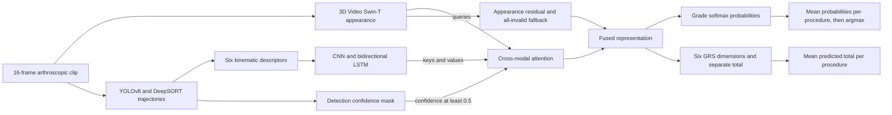

# ArthroSkill-MC

Occlusion-aware multimodal skill assessment across arthroscopic joints and hospitals.

This repository provides a PyTorch implementation of a Video Swin-T appearance encoder, instrument-motion encoder, confidence-masked cross-attention and separate grade/GRS heads. It also provides procedure-level evaluation and source-data statistical reanalysis.

The benchmark contains 196 knee and shoulder procedures from three hospitals. The fixed partition contains 117 training, 39 validation and 40 test procedures. Skill labels are novice, intermediate and expert. Six GRS dimensions range from 1 to 5; the total ranges from 6 to 30.

## Method and principal results

The method achieves 87.5% accuracy on the fixed 40-procedure test partition, while leave-one-site-out evaluation yields 64.3%, highlighting the remaining cross-site generalisation gap.



| Evaluation protocol | Procedures | Correct | Accuracy, Wilson 95% CI | GRS MAE | Pearson r |
| --- | ---: | ---: | ---: | ---: | ---: |
| Fixed test partition | 40 | 35 | 87.5% (73.9-94.5%) | 1.537 | 0.957 |
| Three-fold LOSO, pooled | 196 | 126 | 64.3% (57.4-70.7%) | 4.380 | 0.634 |

These values are recomputed from the **current public procedure predictions**, identified by the workbook checksum in [the manifest](data/source_data/manifest.json). The fixed test is small, and none of the seven paired main-model comparisons is below 0.05 after Holm adjustment. LOSO uses a separate fitting protocol; pooled procedures and folds are not independent training replications. See [RESULTS.md](RESULTS.md) for paired tests, visibility analyses and limitations.

## Five-minute CPU Quickstart

After installing the locked environment below, one command validates all public tables, performs the complete statistical reanalysis and checks every analysis field against the committed reference:

```bash
python scripts/quickstart.py --output outputs/quickstart
```

No GPU, private workbook, clinical video or fitted study model is required. The full run took 95.2 seconds on an Apple M1 CPU with 8 GB shared memory; the five-minute scope excludes package downloads and installation.

| Generated file | Purpose |
| --- | --- |
| `outputs/quickstart/validation.json` | Integrity and joins for 24 CSV tables, 196 procedures and 1,527 annotated clips |
| `outputs/quickstart/analysis.json` | Full 20,000-bootstrap / 99,999-swap statistical reanalysis |
| `outputs/quickstart/verification.json` | Numerical comparison with the current committed reference, source checksum and elapsed time |
| `outputs/quickstart/environment.json` | Python, package, platform and CUDA/GPU availability records |

Check for `passed: true`, fixed-test `correct: 35`, `n: 40`, `mae: 1.537`, `pearson_r: 0.9573869018`, and pooled LOSO `correct: 126`, `n: 196`, `mae: 4.3803979592`. Floating-point roundoff is allowed; changed numerical results cause failure. Use a new empty output directory for each run.

For an optional synthetic official SAIS training/evaluation cycle:

```bash
python scripts/setup_sais.py --destination external/SAIS
python scripts/smoke_test.py --sais-root external/SAIS --output outputs/smoke
```

This generates random paired RGB/flow feature fixtures, a selected checkpoint in `outputs/smoke/training`, procedure predictions in `outputs/smoke/evaluation/sais_evaluation.json`, and `outputs/smoke/smoke_report.json`. The measured two-epoch fitting/checkpoint/evaluation cycle took 10.8 seconds. It tests executable software behaviour and does not measure study performance or validate video feature extraction.

## Installation

For the tested public-data/model-validation profile, use Python **3.12.14**:

```bash
python3.12 -m venv .venv
source .venv/bin/activate
# Linux only: select CPU wheels before installing the full lock file.
python -m pip install torch==2.8.0 torchvision==0.23.0 --index-url https://download.pytorch.org/whl/cpu
# Linux and macOS:
python -m pip install -r requirements-lock.txt
python -m pip check
```

The broad `requirements.txt` remains available for development and raw-video workflows. [Environment details](docs/environment.md) distinguish validated CPU versions, the manuscript's RTX 3090 inference benchmark and unverified historical CUDA/training-time fields. [CI](https://github.com/Irene-NingXi/ArthroSkill-MC/actions/workflows/reproducibility.yml) installs a fresh pinned CPU environment, tests the pinned official SAIS model, recomputes current-source statistics and runs the synthetic fitting/evaluation cycle.

Use a compatible PyTorch/torchvision pair. CUDA is optional for statistical reanalysis; training full-resolution video requires an appropriate GPU.

## Source-data analysis

```bash
python scripts/validate_source_data.py --data data/source_data
python scripts/analyze_predictions.py --data data/source_data --output outputs/source_data_analysis.json
```

The [public English source-data package](data/source_data/README.md) contains 24 CSV tables covering all 22 source worksheets, including independent ratings, exact procedure partitions, procedure/clip predictions and recorded summary snapshots. Surgeon linkage IDs and the original workbook container are withheld. The command recomputes results directly from the public tables; a private workbook is not required. Defaults are 20,000 procedure-bootstrap samples, 99,999 procedure-level swaps and analysis seed 20261020. Visibility annotation-agreement intervals use seed 20261021. Seven fixed-test comparisons and six visibility comparisons receive separate Holm adjustments. Training repeats remain aggregate summaries of the same partition.

See [RESULTS.md](RESULTS.md) for source-data results and [the protocol](docs/protocol.md) for definitions and reproducibility boundaries. Statistical reanalysis does not train a model.

## Prepare training data

The source recordings are restricted under institutional ethics approvals. The public source tables contain ratings, partitions and recorded predictions rather than training videos.

```bash
python scripts/prepare_metadata.py --data data/source_data --videos /path/to/videos --output metadata.csv
python scripts/extract_motion.py --metadata metadata.csv --weights /path/to/training_only_detector.pt --output processed
```

Metadata export preserves the supplied procedure partition and averages the two raters' six dimension scores. Motion extraction checks 25 fps input, screens brightness below 30 and Laplacian variance below 100, performs per-video intensity normalisation and writes non-overlapping 16-frame clips with original frame indices. Train the arthroscopy detector on the eligible training procedures before extraction; generic object-detection weights do not establish instrument-detection validity.

Set `model.appearance.checkpoint` in `configs/config.yaml` to a HeiChole-adapted backbone state dictionary. Study training rejects a null or missing checkpoint, preventing silent omission of the surgical adaptation stage. Direct backbone construction can still use Kinetics-400 weights for separate experiments. Checkpoints from the earlier 2D backbone are incompatible with the 3D backbone and require retraining.

## Training and evaluation

```bash
python train.py --config configs/config.yaml --data processed --output outputs/main
python evaluate.py --config configs/config.yaml --data processed --checkpoint outputs/main/best_model.pth --split test --output outputs/test
python scripts/run_ablation.py --config configs/config.yaml --data processed --variant unmasked --output outputs/unmasked
python scripts/train_video_baselines.py --config configs/config.yaml --data processed --model resnet3d --pretrained --output outputs/resnet3d
python evaluate.py --data processed --checkpoint outputs/resnet3d/resnet3d_best.pth --split test --output outputs/resnet3d/test
python scripts/train_loso.py --config configs/config.yaml --data processed_loso --output outputs/loso
```

Ablation choices are `appearance_only`, `motion_only`, `naive_concat`, `unmasked` and `full`. Shared internal appearance branches must use the same adapted checkpoint. External Video Swin-T uses Kinetics-400 weights. The official RGB-and-flow SAIS adapter invokes the pinned external SAIS implementation and its learned-prototype pathway. See [SAIS integration](docs/sais.md) for setup, DINO/RAFT feature extraction, constant-learning-rate training and procedure-level evaluation.

Validation selects the best checkpoint using procedure accuracy. Each procedure's clip softmax probabilities are averaged before argmax; continuous scores are averaged independently. Evaluation defaults to the test partition. All-invalid motion clips use the appearance residual pathway and never evaluate an all-masked softmax.

## Official SAIS comparator

```bash
python scripts/setup_sais.py --destination external/SAIS
python scripts/extract_sais_features.py --config configs/config.yaml --metadata metadata.csv --clips processed --output sais_features --dino-weights weights/dino_deitsmall16_pretrain.pth --raft-weights weights/raft_things.ckpt --device cuda
python scripts/train_sais.py --config configs/config.yaml --data sais_features --output outputs/sais/seed3407 --seed 3407
python scripts/evaluate_sais.py --data sais_features --checkpoint outputs/sais/seed3407/sais_best_model.pth --split test --output outputs/sais/seed3407/test
```

The [SAIS guide](docs/sais.md) specifies optional extraction dependencies, external licenses, clip/flow alignment, weight requirements and the differences between the released generic recipe and this study's matched optimisation settings. SAIS reports classification only.

## Validation

```bash
python -m unittest discover -s tests -v
```

Tests cover exact procedure assignments, checkpoint restoration, deterministic evaluation, masked attention, all-invalid fallback, gradients, probability aggregation, score units and the spatiotemporal backbone. They do not establish the reported trained-model performance.

## Data and code availability

De-identified study source tables are publicly available under [data/source_data](data/source_data/README.md), with file checksums and a complete English data dictionary. They support statistical reanalysis of recorded results. Raw surgical recordings and identity mappings are not distributed. Independent end-to-end reproduction additionally requires authorised recordings, detector annotations and weights, the HeiChole adaptation checkpoint and matching fitted model checkpoints/configurations. Recorded SAIS score fields and older summary discrepancies are preserved with explicit interpretation notes.

## Versioned release and citation

The paper snapshot is identified by code tag [`v1.0-paper`](https://github.com/Irene-NingXi/ArthroSkill-MC/releases/tag/v1.0-paper) and public-data release identifier **`v5-public-1`**. The [release mapping](docs/release.md) records the current data checksum, manuscript checksum, archive contents and Zenodo DOI status. Use the tag when citing a stable snapshot; `main` can continue to evolve. Citation metadata is provided in [CITATION.cff](CITATION.cff).

## Author and licence

Ning Xi. Software uses the MIT licence; see [LICENSE](LICENSE). Source-data access and reuse are described in [data terms](data/source_data/TERMS.md). Third-party datasets, weights and implementations retain their respective terms.
